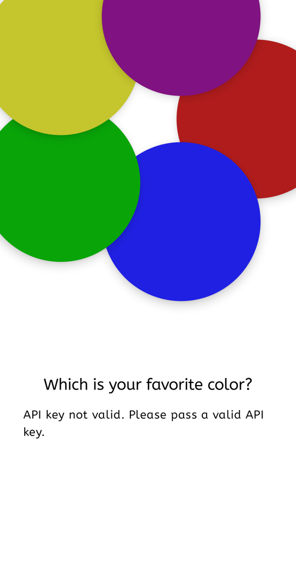
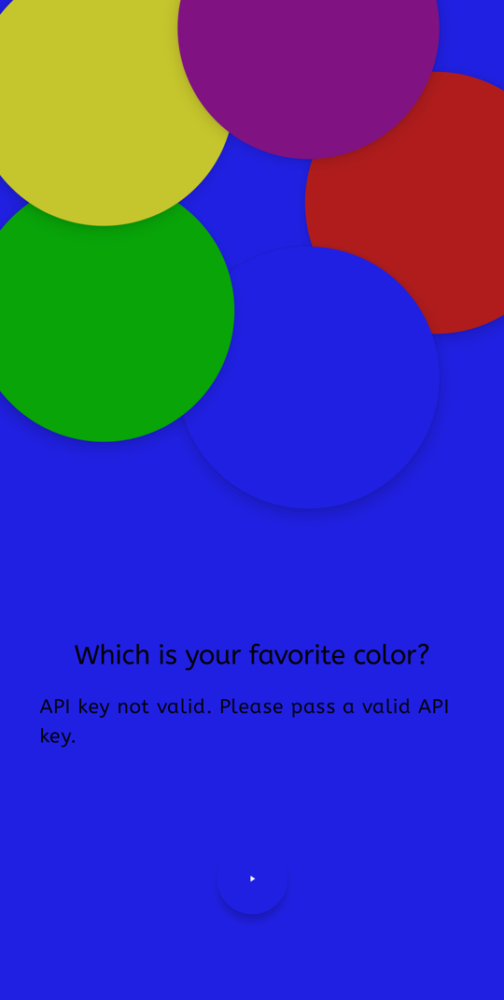

# 🎨 Adapt

> An early prototype of an Android app that asks "Which is your favorite color?", tints the screen with the answer and asks Google's Gemini model to describe the user in five adjectives.

---

## Project at a glance

| | |
|---|---|
| **Date** | 23-26 June 2025 (7 commits, first `ff3c5bc`, last `c41ae6a`) |
| **Context** | Personal project / prototype. The repository does not say whether it belongs to a course or an employer, so this is not stated here. |
| **Team** | One committer in the git history (`Davila`, i.e. the repository owner João Davila) |
| **Stack** | Kotlin 2.0.21, Jetpack Compose (Material 3), Hilt, Jetpack DataStore, Google AI client SDK for Android (`generativeai` 0.9.0), Gradle Kotlin DSL / AGP 8.10.1 |
| **Language** | Kotlin; UI text in English |

## The purpose

"Adapt" is the app's name (`app_name` in `strings.xml`) and the name is never explained in the repository. From the code, the idea being explored is an app that **adapts itself to the user from a few answers**: the first "question screen" asks for a favorite color, the background changes to that color, the answer is stored on the device, and a generative model is prompted to produce a short personality description from the color. The commit messages ("Finishing 1st version of Question 1", `QuestionScreen`, `Routes.QUESTION`) suggest more questions were planned; only the first exists.

## What it does

1. On launch, `QuestionViewModel` reads the saved favorite color from DataStore and shows a full-screen loading animation until it arrives.
2. `QuestionScreen` shows five animated "jelly" buttons (red, blue, green, yellow, purple) placed on a circle (`CircularLayout`).
3. Tapping one animates the background to that color over 2 seconds, saves the color name in DataStore (`favorite_color` key), and shows a pulsing "forward" button.
4. Whenever the selected color changes, the app sends a prompt to Gemini (`gemini-1.5-flash`) asking for a description of the person in at most five adjectives, in the format `He is [adjective1], ... [adjective5].` (`util/Prompts.kt`). While waiting a three-dot loader is shown, then the answer (or the error message) is rendered under the question.

## Architecture

A small clean-architecture layout, single module `:app`, package `com.example.adapt`:

| Layer | Contents |
|---|---|
| `ui/question` | `QuestionScreen` (Compose UI), `QuestionViewModel` + `QuestionUiState`, `QuestionAction` (`SaveFavoriteColor`, `SendPrompt`) |
| `ui/composables` | `JellyButton`, `ForwardButton`, `CircularLayout`, loading animations |
| `ui/navigation` | `AppNavigation` (Navigation Compose, single `question` route) |
| `domain/usecase/color` | `SaveFavoriteColorUseCase`, `GetFavoriteColorUseCase`, `SendPromptUseCase` (calls Gemini, emits `Loading / Success / Error`) |
| `data` | `UserRepository` over `DataStoreManager` (Preferences DataStore) |
| `di` | Hilt modules `AppModule`, `UseCaseModule` |

The API key is not in the source: the Secrets Gradle plugin exposes `apiKey` from `local.properties` as `BuildConfig.apiKey`.

## Screenshots

Taken on an Android emulator (API 34, 1080x2400) from a debug build of this repository, with a placeholder API key, so the Gemini request is rejected and the app shows the real error message. Status bar and navigation bar were cropped.

| First screen | After tapping Blue |
|---|---|
|  |  |

On that emulator the five buttons are scaled up and overflow the screen edges and the button labels are not visible; the layout was not tuned for this screen size.

## Running it

Verified: with JDK 21 and the Android SDK (platform 35) the project built unmodified with `:app:assembleDebug` using the wrapper (Gradle 8.11.1), and installed and launched on an API 34 emulator.

```bash
# 1. local.properties (git-ignored) needs the SDK path and a Gemini API key:
#    sdk.dir=/path/to/Android/sdk
#    apiKey=<your Gemini API key>
# 2. build (the gradlew file is committed without the executable bit)
sh ./gradlew :app:assembleDebug
adb install -r app/build/outputs/apk/debug/app-debug.apk
```

Not verified: a successful Gemini response (no valid key was used, and `gemini-1.5-flash` may no longer be served by the API).

## Status

Unfinished first iteration.

- Only "Question 1" exists; the forward button's click handler is commented out (`// onAction(QuestionAction.Next)`) and the `home` route is declared but unused.
- `BakingScreen.kt` / `BakingViewModel.kt` / the baked-goods images and strings are left over from Google's "Baking with Gemini" sample and are not wired into navigation.
- `QuestionUiState` carries a `//TODO` to split into several state types.
- The prompt is built from `Color.toString()` of the selected Compose color rather than the color name, and refers to the user as "he".
- Only the template tests exist (`ExampleUnitTest`, `ExampleInstrumentedTest`).
- Minor naming/package oddities: the file `SendPrompUseCase.kt` contains `SendPromptUseCase`; theme files use packages `com.example.compose` / `com.example.ui.theme`.

## Limitations of the time (and of this code)

- Targets Android 11+ (`minSdk 30`, `compileSdk`/`targetSdk` 35) and the 2025-era Gemini 1.5 Flash model through the client SDK, which embeds the API key in the APK at build time. That is fine for a prototype but not safe for distribution; a backend proxy would be needed.
- No offline mode, retry or localisation; all strings besides a few resources are hard-coded in the composables.
- Prompt output is not validated against the requested format, and the personal description is only a toy; it infers nothing real about a person.
- No automated tests of the actual behaviour.

## Credits

- João Davila ([@joaodavil4](https://github.com/joaodavil4)): author of all commits.
- Baked-goods images and the Baking screen come from Google's "Baking with Gemini" Android sample (the code comments say the images were generated with Gemini).
